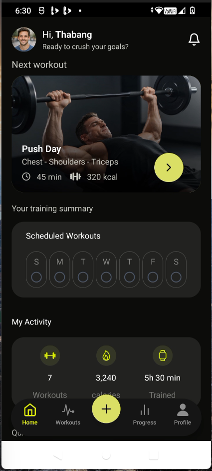
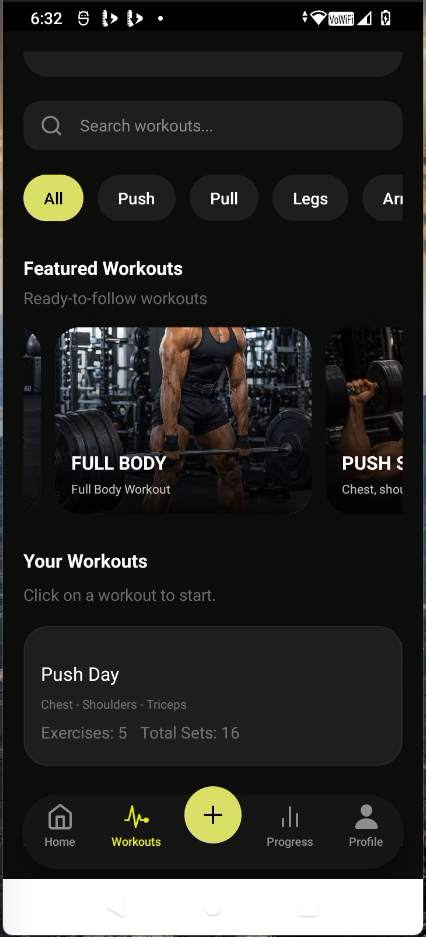
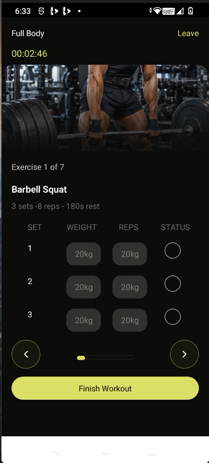
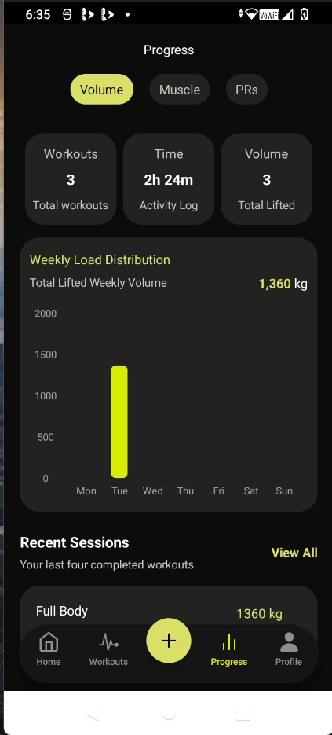
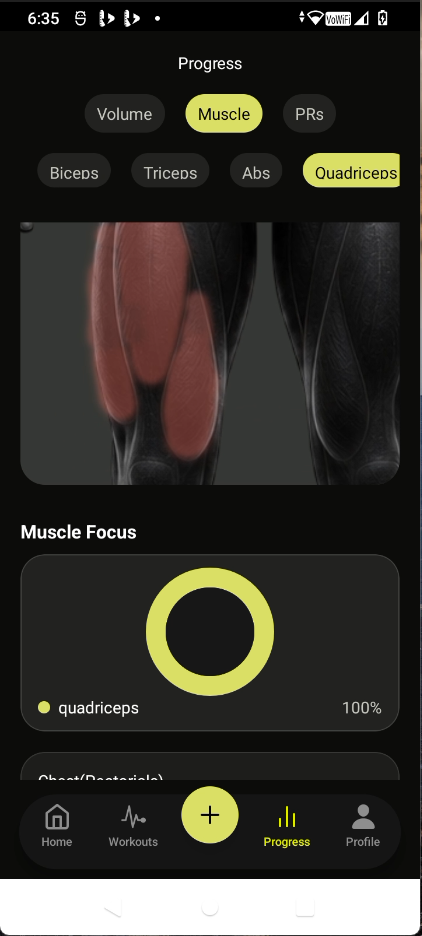
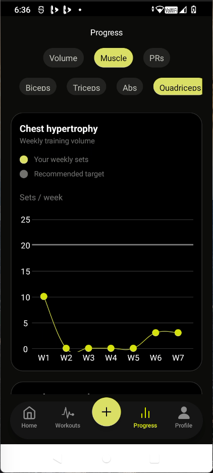
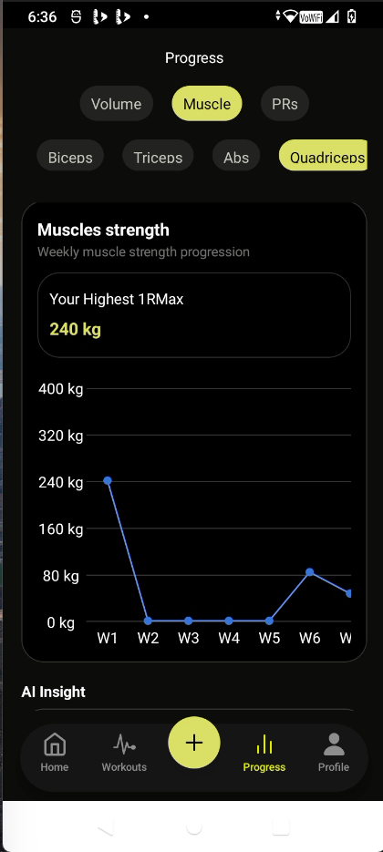

# Forge AI Fitness

**A full-stack fitness tracking application built to help users manage workouts, monitor training volume, and track strength progression with AI.**

# Forge AI Fitness

**Turning workout history into actionable insights on strength, training consistency, and progress.**

Forge started with a personal problem: I wanted a better way to track my workouts, measure my strength progression, and recognize when my training was becoming stagnant.

Recording workouts alone wasn't enough. I wanted to understand whether I was actually getting stronger, how consistently I was training each muscle group, and whether my training history showed signs of stalled progress.

I built Forge to address that gap — transforming workout records into meaningful performance metrics, including weekly training volume, muscle-specific training trends, and estimated one-rep max progression.

Beyond tracking what I've done in the gym, my goal is to build a system that helps me understand what my training data reveals, identify patterns over time, and make more informed decisions about my next workout.

**Forge is both a personal fitness tool and an ongoing exercise in full-stack engineering**, combining mobile development, backend data processing, relational database design, and performance analytics to solve a problem I experience firsthand.

> **Project status:** In development

## Features

### Workout Management

- Browse workouts organized by training type, including push, pull, legs, arms, shoulders, and core.
- View workout details and associated exercises.
- Track sets, repetitions, weights, and rest periods.
- Record completed workout sessions.

### Training Analytics

- View workout statistics and recent training activity.
- Track weekly training volume.
- Analyze training distribution across muscle groups.
- Compare weekly working-set volume against a configurable training target.

### Strength Progression

- Track exercise performance over time.
- Calculate estimated one-rep maximums using the Epley formula.
- Review personal records and strength trends.
- Represent weeks without training data consistently in historical charts.

### Mobile Experience

- Built with React Native and Expo.
- Uses a dark, minimal interface with high-contrast visual elements.
- Provides dedicated workout, progress, and profile experiences.

### AI Chat Coach

- Receive personalized insights and recommendations based on workout history and performance metrics.
- Identify trends in strength progression, including signs of improvement, decline, or stagnation over time.
- Get guidance on training volume, workout consistency, and muscle-specific progress.
- Ask questions about training performance and receive data-informed feedback to support better workout decisions.

## Tech Stack

| Area                        | Technologies                    |
| --------------------------- | ------------------------------- |
| Mobile frontend             | React Native, Expo, Expo Router |
| Styling                     | NativeWind                      |
| API state and data fetching | Redux Toolkit Query             |
| Backend                     | Node.js, Express                |
| Database                    | PostgreSQL with Neon            |
| ORM                         | Drizzle ORM                     |
| Authentication              | Better Auth                     |
| Validation                  | Zod                             |
| Image handling              | ImageKit                        |
| Language                    | TypeScript                      |

## Engineering Highlights

### Backend-Driven Analytics

Workout statistics are calculated on the backend rather than relying entirely on client-side calculations. This helps keep business logic consistent and makes the results reusable across different screens.

### Timezone-Aware Weekly Aggregation

Training records are grouped using the `Africa/Johannesburg` timezone so weekly analytics align with local calendar dates. PostgreSQL date functions are used to establish week boundaries and aggregate training data.

### Historical Strength Metrics

The application uses the Epley formula to estimate one-rep maximums:

`Estimated 1RM = Weight × (1 + Reps / 30)`

This provides a standardized estimate for comparing performance across sessions. It is an estimate, not a direct measurement of maximal strength.

### API Data Management

Redux Toolkit Query manages API requests and cached responses. Query tags and invalidation can be used to keep relevant statistics updated after workout data changes.

### Structured Data Access

Drizzle ORM provides a typed interface for database queries, while PostgreSQL handles relational data and aggregation.

## Architecture

The application separates the mobile interface, backend API, and database responsibilities.

```text
React Native / Expo
        |
        v
Redux Toolkit Query
        |
        v
Express REST API
        |
        v
Drizzle ORM
        |
        v
PostgreSQL (Neon)
```

- **Frontend:** Renders the mobile interface and manages client-side API state.
- **Backend:** Handles request processing, validation, authentication, and application business logic.
- **Database:** Stores workout definitions, exercises, workout sessions, and recorded sets.
- **Analytics:** Processes historical workout data into weekly volume, muscle distribution, and strength metrics.

## Getting Started

### Prerequisites

- Node.js and npm
- Git
- Expo Go or an Android development environment
- A PostgreSQL database, such as Neon
- Required authentication and image-service configuration

### 1. Clone the repository

```bash
git clone https://github.com/thabangsonique/Forge-AI-Fitness-App
cd Forge-AI-Fitness-App
```

### 2. Install the backend dependencies

```bash
cd Backend
npm install
```

Create a backend environment file using the variables required by your configuration. Configure your database connection, authentication secrets, and any required image-service credentials.

Run the database migrations or setup commands defined in the backend scripts.

Start the backend using the appropriate script from `Backend/package.json`.

### 3. Install the frontend dependencies

Open a separate terminal:

```bash
cd Frontend
npm install
```

Configure the API base URL so the mobile application can reach your backend. When testing on a physical phone, use an address reachable from the phone rather than assuming `localhost` refers to your computer.

Start the Expo development server using the script defined in `Frontend/package.json`.

> **Setup note:** Update the folder names, environment variables, migration commands, and npm scripts above to match the actual repository before publishing this README.

## Screenshots

## App Screenshots

Forge is designed around a clean, dark mobile interface that makes workout tracking and performance analytics easy to navigate.

### Home Dashboard

The main dashboard provides an overview of the user's fitness activity and access to core features.


### Workout Tracking

Browse workouts, view exercise details, and record sets, repetitions, and weights during a workout session.




### Training Analytics

Visualize weekly training volume, muscle-group distribution, and progress toward training targets.






### Strength Progression & Personal Records

Review estimated one-rep max trends and personal records to understand how strength changes over time.


### AI Chat Coach - (In-development)

Explore personalized, data-informed insights into training performance, consistency, and progression.

## Current Development Focus

- Refining workout analytics and historical data aggregation.
- Improving muscle-specific training-volume insights.
- Expanding strength progression and personal-record tracking.
- Improving data consistency and the mobile user experience.
- AI chat Coach intergration

## Future Improvements

- **Personalized Training Recommendations:** Develop more tailored recommendations based on training history, performance trends, and individual goals.
- **Intelligent Plateau Detection:** Explore ways to identify sustained periods of stagnant or declining performance using historical workout data.
- **Advanced Performance Analytics:** Expand historical comparisons to help users better understand long-term strength progression and training consistency.
- **Recovery-Aware Training Insights:** Explore incorporating recovery-related information to provide more contextual training guidance.
- **Automated Testing and Continuous Integration:** Introduce automated tests and CI workflows to improve reliability and catch regressions as the application evolves.

These are planned improvements and are not necessarily implemented in the current version.

## What I Learned

Building Forge gave me practical experience in full-stack development, data-driven application design, and applying AI throughout the software development process.

### Full-Stack Engineering

- Designing and consuming REST APIs using React Native, Expo, and Express.
- Structuring backend code into reusable services and maintaining clear separation of responsibilities.
- Modeling relational data with PostgreSQL and Drizzle ORM.
- Managing API requests, caching, and cache invalidation with Redux Toolkit Query.

### Data Processing and Analytics

- Translating workout history into meaningful performance metrics, including weekly training volume and estimated one-rep max progression.
- Writing SQL queries for aggregation, grouping, and timezone-aware date calculations.
- Handling missing historical data so that analytics remain consistent across time periods.
- Understanding how backend data models and calculations influence the accuracy of frontend visualizations.

### AI-Assisted Software Engineering

- Using AI coding assistants to explore unfamiliar concepts, reason through implementation decisions, generate and refine code, and troubleshoot errors.
- Reviewing AI-generated solutions rather than accepting them blindly, checking their compatibility with the existing architecture, types, database schema, and application behavior.
- Breaking complex features into smaller, understandable steps and using AI to accelerate development while strengthening my understanding of the underlying code.
- Learning to treat AI as a development assistant rather than a replacement for engineering judgment, testing, or understanding.

### AI Integration Within an Application

- Exploring how AI capabilities can be integrated into a mobile application through a chat-based coaching experience.
- Connecting AI-driven interactions with workout history and performance metrics to support personalized, data-informed guidance.
- Understanding the importance of providing relevant context to AI systems so their responses are more useful than generic chatbot answers.
- Learning to consider response quality, error handling, data privacy, and the reliability of AI-generated recommendations when designing AI-powered features.

### Engineering Growth

- Turning a personal problem into a working software solution.
- Evaluating implementation trade-offs and understanding how frontend, backend, database, and AI components work together.
- Iteratively improving features through debugging, testing, and reviewing implementation decisions.

## Author

**Thabang Muleba**

Software Engineering student focused on building full-stack applications and developing practical skills in mobile development, backend engineering, database design, and data-driven features.

- GitHub: https://github.com/thabangsonique
- Portfolio: https://thabangportfoliosite.netlify.app/
